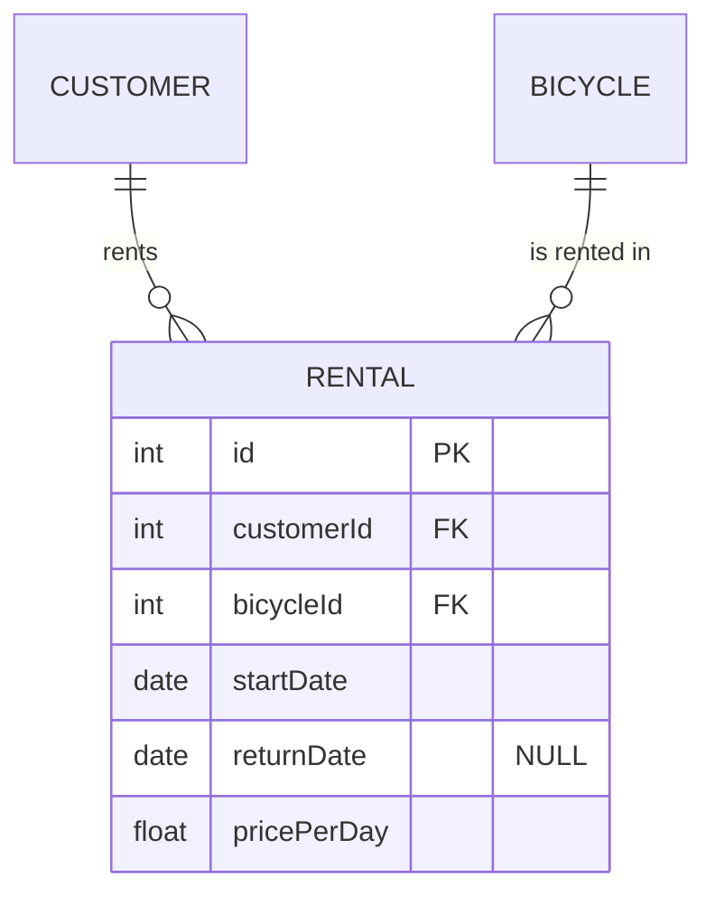

# ⚔️ Manual del Joven Padawan — Sequelize

> Joven padawan, escucha a tu maestro:
> **Ya has construido esta nave antes.** En el simulacro creaste `Model`, lo uniste a `Bicycle` e hiciste consultas anidadas.
> En el examen no inventarás nada: **copiarás lo que ya sabes y cambiarás los nombres.**
> El miedo es el camino hacia el error de sintaxis. Respira. Sigue los pasos en orden.

---

## 🗺️ Mapa del manual

| Parte | Qué hay | Cuándo usarla |
|---|---|---|
| **[PARTE 1 — Crear el modelo](#parte-1--crear-el-modelo-nuevo)** | Pasos 1 al 6 | Lo primero del examen |
| **[PARTE 2 — Hacer la consulta](#parte-2--hacer-la-consulta)** | Las 3 piezas + piezas del sable de luz | Lo segundo del examen |
| **[PARTE 3 — Probar en Postman](#parte-3--probar-en-postman)** | Bodies listos para copiar | Para comprobar que todo va |
| **[PARTE 4 — Chuleta de consultas](#parte-4--chuleta-de-consultas)** | Tus consultas + 24 de entrenamiento | Cuando no sepas cómo escribir la consulta |
| **[PARTE 5 — Si algo falla](#parte-5--si-algo-falla-señales-del-lado-oscuro)** | Errores y soluciones | Cuando salga rojo en la terminal |
| **[PARTE 6 — Atributo null y enlaces](#parte-6--atributo-null-y-entidades-enlazadas-a-varios)** | Campo null, enlazar a varios y ejemplo completo | Si la entidad tiene un campo opcional |
| **[Checklist final](#-checklist-del-padawan)** | Para ir marcando | Durante todo el examen |

---

# PARTE 1 — Crear el modelo nuevo

> 🌌 **La idea:** modelo nuevo = copiar la carpeta `brands` (o `models`), cambiar los nombres y añadir el campo que lo une al otro modelo.

En los ejemplos uso `Review` (reseñas de bicis). En el examen cambia `Review`/`review` por lo que diga el profe.

---

## PASO 1 — Clonar la carpeta

1. Copia la carpeta `src/modules/brands`
2. Pégala y llámala como el modelo nuevo (ej: `reviews`)
3. Renombra los 4 archivos:
   - `brand.model.ts` → `review.model.ts`
   - `brand.service.ts` → `review.service.ts`
   - `brand.controller.ts` → `review.controller.ts`
   - `brand.routes.ts` → `review.routes.ts`
4. Dentro de cada archivo: **Buscar y reemplazar** (`Ctrl + H`) con mayúsculas activadas (`Aa`):
   - `Brand` → `Review`
   - `brand` → `review` *(esto cambia también `brands` → `reviews`)*

✅ El CRUD ya está hecho.

### ⚠️ ¿El nombre choca con Sequelize?

Si el modelo se llama como algo de Sequelize (`Model`, `Op`, `DataTypes`, `Sequelize`), renombra el de Sequelize al importarlo. Es lo que hiciste en el simulacro:

```ts
import {
  Model as SequelizeModel,      // 👈 el Model de Sequelize pasa a llamarse SequelizeModel
  DataTypes,
  InferAttributes,
  InferCreationAttributes,
  CreationOptional,
} from "sequelize";

export class Model extends SequelizeModel<     // 👈 aquí también
  InferAttributes<Model>,
  InferCreationAttributes<Model>
> { ... }
```

---

## PASO 2 — Poner los campos en el modelo

En `review.model.ts` cada campo se escribe en **2 sitios**.

**Arriba (en la clase):**
```ts
declare bicycleId: number;     // 👈 el campo que une con el otro modelo
declare rating: number;
declare comment: string;
```

**Abajo (en el `init`):**
```ts
bicycleId: {
  type: DataTypes.INTEGER.UNSIGNED,
  allowNull: false,
},
rating: {
  type: DataTypes.INTEGER,
  allowNull: false,
},
comment: {
  type: DataTypes.STRING(150),
  allowNull: false,
},
```

📜 **Tipos:**

| Quiero guardar… | Pongo |
|---|---|
| número entero | `DataTypes.INTEGER` |
| id / campo que une | `DataTypes.INTEGER.UNSIGNED` |
| texto | `DataTypes.STRING(150)` |
| precio | `DataTypes.DECIMAL(10, 2)` |
| fecha | `DataTypes.DATE` |

Si no se puede repetir: añade `unique: true`.
Si el campo **puede ser null** (opcional): mira la [Parte 6](#parte-6--atributo-null-y-entidades-enlazadas-a-varios).

---

## PASO 3 — (Solo si hace falta) Sustituir un campo del modelo viejo

> Hazlo **solo si** el profe dice que un campo que ya existe pasa a ser una tabla. Es lo que hiciste en el simulacro: el texto `model` de `Bicycle` pasó a ser `modelId`, que apunta a la tabla `models`.
> Si no te lo piden, **sáltate este paso.**

Busca con `Ctrl + F` el campo antiguo y cámbialo en estos **5 sitios**:

| # | Archivo | Antes | Después |
|---|---|---|---|
| 1 | `bicycle.model.ts` (clase) | `declare model: string;` | `declare modelId: number;` |
| 2 | `bicycle.model.ts` (init) | `model: { type: DataTypes.STRING(150) … }` | ver abajo 👇 |
| 3 | `bicycle.controller.ts` (create) | `const { brandId, model, … }` y `!model` | `const { brandId, modelId, … }` y `!modelId` |
| 4 | `bicycle.service.ts` (create) | `model: string;` | `modelId: number;` |
| 5 | `bicycle.service.ts` (update) | `model?: string;` | `modelId?: number;` |

El campo nuevo en el `init` (es igual que `brandId`, cópialo):
```ts
modelId: {
  type: DataTypes.INTEGER.UNSIGNED,
  allowNull: false,
  references: { model: "models", key: "id" },   // 👈 nombre de la TABLA nueva
  onUpdate: "CASCADE",
  onDelete: "RESTRICT",
},
```
🧘 El `model:` de dentro de `references` es una palabra de Sequelize que significa "tabla". Ahí va el `tableName` de la tabla a la que apuntas.

---

## PASO 4 — Unir los modelos (`associations.ts`)

### ¿Qué relación te piden?

| Te dicen… | Ya lo hiciste en… | Usas |
|---|---|---|
| **1:N** (uno tiene muchos) | Brand → Bicycle, Model → Bicycle | `hasMany` + `belongsTo` |
| **1:1** (uno tiene uno) | Bicycle → BicycleDetail | `hasOne` + `belongsTo` |
| **N:M** (muchos con muchos) | Order ↔ Bicycle | `belongsToMany` x2 + tabla en medio |

### 1:N → "Una bici tiene muchas reviews"
```ts
Bicycle.hasMany(Review, { foreignKey: "bicycleId", as: "reviews" });
Review.belongsTo(Bicycle, { foreignKey: "bicycleId", as: "bicycle" });
```
*(el tuyo del simulacro:)*
```ts
Model.hasMany(Bicycle, { foreignKey: "modelId", as: "bicycles" });
Bicycle.belongsTo(Model, { foreignKey: "modelId", as: "model" });
```

### 1:1 → "Una bici tiene una garantía"
```ts
Bicycle.hasOne(Warranty, { foreignKey: "bicycleId", as: "warranty" });
Warranty.belongsTo(Bicycle, { foreignKey: "bicycleId", as: "bicycle" });
```
*(en el modelo, al campo `bicycleId` añádele `unique: true`)*

### N:M → "Un estudiante tiene muchos cursos y un curso muchos estudiantes"
Necesitas **3 modelos**: los dos lados + la tabla del medio (con los dos ids). Copia lo de Order/OrderItem/Bicycle:
```ts
Student.belongsToMany(Course, { through: Enrollment, foreignKey: "studentId", otherKey: "courseId", as: "courses" });
Course.belongsToMany(Student, { through: Enrollment, foreignKey: "courseId", otherKey: "studentId", as: "students" });
```

### 🧘 Las 3 reglas
1. El campo que une (`bicycleId`, `modelId`…) va **en el modelo hijo** (el que hace `belongsTo`).
2. El `as` es un **apodo**: plural si son muchos (`reviews`), singular si es uno (`bicycle`).
3. **Apúntate el apodo.** Lo necesitas en la consulta.

Y arriba del archivo, el import:
```ts
import { Review } from "../modules/reviews/review.model";
```

---

## PASO 5 — Registrar el modelo (2 líneas)

**`src/server.ts`** (junto a los otros imports de modelos):
```ts
import "./modules/reviews/review.model";
```

**`src/routes/index.ts`**:
```ts
import reviewRoutes from "../modules/reviews/review.routes";
router.use("/reviews", reviewRoutes);
```

---

## PASO 6 — Arrancar

```
npm run dev
```
✅ Si no sale error rojo → la Fuerza está contigo. Pasa a la Parte 2.
❌ Si sale error → [Parte 5](#parte-5--si-algo-falla-señales-del-lado-oscuro).

---

# PARTE 2 — Hacer la consulta

## Las 3 piezas (siempre las mismas, siempre en este orden)

### 🔹 Pieza 1: SERVICE → la consulta
```ts
static async findReviewsOfBicycle(bicycleId: number) {
  return Review.findAll({
    where: { bicycleId },                              // filtro
    include: [{ model: Bicycle, as: "bicycle" }],      // trae el otro modelo (con el APODO)
    order: [["rating", "DESC"]],                       // orden
  });
}
```
*(import arriba: `import { Bicycle } from "../bicycles/bicycle.model";`)*

### 🔹 Pieza 2: CONTROLLER → coge el dato de la URL y llama al service
```ts
static async getReviewsOfBicycle(req: Request, res: Response, next: NextFunction) {
  try {
    const bicycleId = Number(req.params.bicycleId);
    const reviews = await ReviewService.findReviewsOfBicycle(bicycleId);
    res.json(reviews);
  } catch (error) {
    next(error);
  }
}
```

### 🔹 Pieza 3: ROUTES → la URL
```ts
router.get("/bicycle/:bicycleId", ReviewController.getReviewsOfBicycle);
```
⚠️ **Ponla ARRIBA del todo**, antes de `router.get("/:id", ...)`.

🧪 Postman: `GET http://localhost:3000/api/reviews/bicycle/1`

---

## El controller es SIEMPRE el mismo molde

Solo cambias **3 cosas** (👈):

```ts
static async getLoQueSea(req: Request, res: Response, next: NextFunction) {   // 👈 1. nombre
  try {
    const dato = Number(req.params.dato);                                       // 👈 2. el dato de la URL
    const resultado = await XxxService.findLoQueSea(dato);                      // 👈 3. el método del service
    res.json(resultado);
  } catch (error) {
    next(error);
  }
}
```

| Si el dato de la URL es… | Escribes |
|---|---|
| un **número** (id, precio, stock…) | `Number(req.params.loQueSea)` |
| un **texto** (nombre, estado, material…) | `String(req.params.loQueSea)` |
| **dos datos** (`/price/:min/:max`) | dos líneas: `const min = Number(req.params.min);` y `const max = Number(req.params.max);` |
| **ningún dato** (`/brand-and-model`) | quitas esa línea y llamas `findLoQueSea()` sin nada |

🧘 El nombre después de `req.params.` tiene que ser **igual** que lo que va después de `:` en la ruta.

---

## Las piezas de tu sable de luz (combínalas para montar la consulta)

Combina las que te pida el profe:

| Si el profe dice… | Pones… |
|---|---|
| "con sus datos de X" / "ansiosa" / "eager" | `include: [{ model: X, as: "apodo" }]` |
| "con X **y** con Y" | dos objetos: `include: [{ …X… }, { …Y… }]` |
| "con X, y X con su Z" | un `include` **dentro** de otro `include` |
| "de un id concreto" | `where: { bicycleId }` |
| "de mayor a menor" | `order: [["campo", "DESC"]]` |
| "de menor a mayor" | `order: [["campo", "ASC"]]` |
| "que contenga el texto…" | `where: { name: { [Op.like]: `%${texto}%` } }` |
| "mayor que…" | `where: { price: { [Op.gt]: numero } }` |
| "menor que…" | `where: { price: { [Op.lt]: numero } }` |
| "entre … y …" | `where: { price: { [Op.between]: [min, max] } }` |
| "solo los que tengan X" (INNER JOIN) | `required: true` dentro del include |
| "solo algunos campos" | `attributes: ["id", "name"]` |
| "todos los campos menos…" | `attributes: { exclude: ["createdAt", "updatedAt"] }` |
| "mayor o igual" / "menor o igual" | `[Op.gte]` / `[Op.lte]` |
| "distinto de…" | `{ status: { [Op.ne]: "cancelled" } }` |
| "uno de estos valores" | `{ status: { [Op.in]: ["paid", "shipped"] } }` |
| "esto **o** aquello" | `[Op.or]: [{ … }, { … }]` |
| "esto **y** aquello" | los dos campos juntos en el mismo `where` |
| "que sea null" / "que no sea null" | `{ campo: { [Op.is]: null } }` / `{ campo: { [Op.not]: null } }` |
| "los que NO tienen X" | include + `where: { "$apodo.id$": null }` |
| "solo las N primeras" | `limit: N` (con `order`) |

- Si usas `Op` → `import { Op } from "sequelize";`
- Si el filtro es sobre **el otro modelo** → el `where` va **dentro** de su `include`.

### 🧘 El lío de `{ model: Model, as: "model" }`
- `model:` → palabra fija de Sequelize ("¿qué modelo incluyo?")
- `Model` → **tu** clase
- `as: "model"` → el apodo de `associations.ts`

Si fuera `Color` sería `{ model: Color, as: "color" }`. Mismo esquema siempre.

---

# PARTE 3 — Probar en Postman

## Cómo se manda un POST

1. Elige **POST** (a la izquierda de la URL)
2. Escribe la URL (ej: `http://localhost:3000/api/brands`)
3. Pestaña **Body** → **raw** → a la derecha elige **JSON**
4. Pega el JSON y pulsa **Send**
5. **201 Created** → ✅ creado

## ⚠️ El orden: primero padres, luego hijos

La bici tiene **dos padres** (marca y modelo). Cada vez que reinicias el servidor **se borran los datos** y hay que volver a crearlos.

```
1. Brand   2. Model   3. Bicycle   4. BicycleDetail   5. Customer   6. Order   7. OrderItem
```

---

### 1. Marcas → `POST /api/brands`
```json
{ "name": "Orbea" }
```
```json
{ "name": "Specialized" }
```
```json
{ "name": "Trek" }
```
*(id 1, 2 y 3)*

### 2. Modelos → `POST /api/models`
```json
{ "name": "Darthvader" }
```
```json
{ "name": "Skywalker" }
```
```json
{ "name": "Yoda" }
```
*(id 1, 2 y 3)*

### 3. Bicis → `POST /api/bicycles`
Obligatorios: `brandId`, `modelId`, `price`
```json
{ "brandId": 1, "modelId": 1, "description": "Bici de carretera", "price": 2500, "stock": 3 }
```
```json
{ "brandId": 1, "modelId": 2, "description": "Bici eléctrica", "price": 80, "stock": 1 }
```
```json
{ "brandId": 2, "modelId": 3, "description": "Bici de montaña", "price": 800, "stock": 10 }
```
```json
{ "brandId": 3, "modelId": 1, "description": "Bici urbana barata", "price": 60, "stock": 2 }
```
*(id 1, 2, 3 y 4)*

### 4. Detalles → `POST /api/bicycle-details`
Obligatorios: `bicycleId`, `frameMaterial`, `wheelSize`, `weight`. Solo **uno por bici** (1:1).
`frameMaterial`: `Aluminum`, `Carbon`, `Steel` o `Titanium`.
```json
{ "bicycleId": 1, "frameMaterial": "Carbon", "wheelSize": 28, "weight": 7.9, "suspension": "None" }
```
```json
{ "bicycleId": 2, "frameMaterial": "Aluminum", "wheelSize": 29, "weight": 22.5, "suspension": "Front" }
```
```json
{ "bicycleId": 3, "frameMaterial": "Aluminum", "wheelSize": 29, "weight": 13.8, "suspension": "Front" }
```
```json
{ "bicycleId": 4, "frameMaterial": "Steel", "wheelSize": 27.5, "weight": 24.2 }
```

### 5. Clientes → `POST /api/customers`
Obligatorios: `name`, `email` (no se pueden repetir)
```json
{ "name": "Chewbacca", "email": "chewie@kashyyyk.com" }
```
```json
{ "name": "Luke Skywalker", "email": "luke@tatooine.com" }
```
```json
{ "name": "Leia Organa", "email": "leia@alderaan.com" }
```
*(id 1, 2 y 3 — Leia no tendrá pedidos, sirve para ver qué hace `required: true`)*

### 6. Pedidos → `POST /api/orders`
Obligatorios: `customerId`, `orderDate`, `status` (`pending`, `paid`, `shipped`, `cancelled`)
```json
{ "customerId": 1, "orderDate": "2026-09-15", "status": "paid" }
```
```json
{ "customerId": 1, "orderDate": "2026-10-01", "status": "pending" }
```
```json
{ "customerId": 2, "orderDate": "2026-09-20", "status": "shipped" }
```
*(id 1, 2 y 3)*

### 7. Líneas de pedido → `POST /api/order-items`
Obligatorios: `orderId`, `bicycleId`, `quantity` (mínimo 1), `unitPrice`
```json
{ "orderId": 1, "bicycleId": 1, "quantity": 1, "unitPrice": 2500 }
```
```json
{ "orderId": 1, "bicycleId": 2, "quantity": 2, "unitPrice": 80 }
```
```json
{ "orderId": 2, "bicycleId": 3, "quantity": 1, "unitPrice": 800 }
```
```json
{ "orderId": 3, "bicycleId": 4, "quantity": 1, "unitPrice": 60 }
```

### 8. El modelo nuevo del examen (ej: `Review`) → `POST /api/reviews`
Lleva **los campos que pusiste en el modelo** (menos `id`, `createdAt`, `updatedAt`):
```json
{ "bicycleId": 1, "rating": 5, "comment": "Vuela como un caza X" }
```
🧘 Los nombres del body = los de `const { ... } = req.body;` en el `create` del controller. Si no coinciden → **400**.

---

## Editar y borrar

**PUT** `/api/bicycles/1` → solo lo que cambias:
```json
{ "price": 2300, "modelId": 2 }
```
**DELETE** `/api/bicycles/4` → **sin body**. **204** → ✅ borrado.
⚠️ No puedes borrar una marca o un modelo que tenga bicis (sale **500**). Borra antes sus bicis.

## Qué significa cada respuesta

| Código | Significado |
|---|---|
| **200** | Todo bien (GET / PUT) |
| **201** | Creado (POST) ✅ |
| **204** | Borrado (DELETE) ✅ |
| **400** | Falta un campo obligatorio en el body |
| **404** | No existe ese id, o la ruta está mal escrita |
| **500** | Error del servidor → mira la **terminal**, ahí sale el error real |

## Las URL para probar tus consultas del proyecto
```
GET /api/bicycles/brand-and-model
GET /api/bicycles/price-greater-than/100
GET /api/bicycles/eagerly/1
GET /api/bicycles/eagerly/frame-material/Carbon
GET /api/orders/customers/1
GET /api/orders/bicycles/price-less/100/weight-greater/20
GET /api/customers/chew/orders
GET /api/order-items/order/1
```

---

# PARTE 4 — Chuleta de consultas

## 🧭 ¿Qué consulta copio?

Busca la frase del profe y ve a la consulta indicada:

| El profe dice… | Copia… |
|---|---|
| "X con los datos de su padre" | **P1** |
| "X con todos sus Y" | **E1** o **E7** |
| "con X **y** con Y a la vez" | **P2** o **E5** |
| "mayor que / menor que" | **P3** o **E4** |
| "entre … y …" | **E3** |
| "que contenga el texto…" (en el mismo modelo) | **P6** |
| "que contenga el texto…" (en el otro modelo) | **E2** |
| "filtrar por un campo del otro modelo" | **P4** |
| "las cosas de un id, ordenadas" | **P5** |
| "con estado / tipo igual a…" | **E6** |
| "muchos a muchos" / tabla intermedia | **E8** o **E9** |
| "filtrando en una tabla que está dentro de otra" | **P7** o **E10** |
| "X con sus Y, y cada Y con sus Z" | **E11** |
| "que el campo esté vacío / sea null" | **E12** |
| "los que NO tienen X" | **E13** o **E14** |
| "las N más caras / más baratas" | **E15** |
| "entre dos fechas" | **E16** |
| "con estado A o B" (varios valores) | **E17** |
| "que cumpla esto **o** aquello" | **E18** |
| "que cumpla esto **y** aquello" | **E19** o **E20** |
| "X de los Y cuyo nombre contiene…" | **E21** |
| "mayor o igual que…" | **E22** |
| "cuántos / contar" | **E23** |
| "sin las fechas" / "todos los campos menos…" | **E24** |

- **P** = consultas que **ya tienes en tu proyecto**
- **E** = consultas de **entrenamiento** (nuevas)

---

## 📚 P — Las consultas de tu proyecto

### P1 · Una bici con su marca → `GET /api/bicycles/eagerly/:id`
`bicycle.service.ts`
```ts
static async findEagerlyById(id: number) {
  return Bicycle.findByPk(id, {
    include: [{ model: Brand, as: "brand" }],
  });
}
```

### P2 · Bicis con su marca Y su modelo → `GET /api/bicycles/brand-and-model`
`bicycle.service.ts`
```ts
static async findAllWithBrandAndModel() {
  return Bicycle.findAll({
    include: [
      { model: Brand, as: "brand" },
      { model: Model, as: "model" },
    ],
    order: [["id", "ASC"]],
  });
}
```
🧘 Dos `include` separados por coma = dos JOIN. La ruta no tiene dato → el controller llama `findAllWithBrandAndModel()` sin nada.

### P3 · Bicis más caras que un precio → `GET /api/bicycles/price-greater-than/:price`
`bicycle.service.ts`
```ts
static async findByPriceGreaterThan(price: number) {
  return Bicycle.findAll({
    where: { price: { [Op.gt]: price } },
    order: [["price", "ASC"]],
  });
}
```

### P4 · Bicis de un material (filtro en el otro modelo) → `GET /api/bicycles/eagerly/frame-material/:frameMaterial`
`bicycle.service.ts`
```ts
static async findAllEagerlyByFrameMaterial(frameMaterial: string) {
  return Bicycle.findAll({
    include: [{
      model: BicycleDetail, as: "detail",
      where: { frameMaterial },
    }],
    order: [["id", "ASC"]],
  });
}
```

### P5 · Pedidos de un cliente por fecha → `GET /api/orders/customers/:id`
`order.service.ts`
```ts
static async findByCustomerId(customerId: number) {
  return Order.findAll({
    where: { customerId },
    include: [{ model: Customer, as: "customer", attributes: ["id", "name", "email"] }],
    order: [["orderDate", "DESC"]],
  });
}
```

### P6 · Clientes cuyo nombre contiene un texto, con sus pedidos → `GET /api/customers/:name_search/orders`
`customer.service.ts`
```ts
static async findCustomersWithOrdersByNameSearch(nameSearch: string) {
  return Customer.findAll({
    where: { name: { [Op.like]: `%${nameSearch}%` } },
    include: [{ model: Order, as: "orders", required: true }],
  });
}
```

### P7 · Pedidos con bicis baratas Y pesadas → `GET /api/orders/bicycles/price-less/:price/weight-greater/:weight`
`order.service.ts`
```ts
static async findWithCheapAndHeavyBicycles(maxPrice: number, minWeight: number) {
  return Order.findAll({
    include: [{
      model: Bicycle, as: "bicycles",
      where: { price: { [Op.lt]: maxPrice } },        // 👈 filtro en la bici
      required: true,
      include: [{
        model: BicycleDetail, as: "detail",
        where: { weight: { [Op.gt]: minWeight } },    // 👈 filtro en el detalle
        required: true,
      }],
    }],
    order: [["id", "ASC"]],
  });
}
```
🧘 Como un caza X dentro del hangar de un Destructor Estelar: Pedido → Bici → Detalle. Cada `where` va dentro del include de **su** tabla. El controller tiene 2 datos (`price` y `weight`).

### P8 · Líneas de un pedido + total → `GET /api/order-items/order/:orderId`
`order-item.service.ts`
```ts
static async findByOrderId(orderId: number) {
  const items = await OrderItem.findAll({
    where: { orderId },
    include: [
      { model: Order, as: "order", attributes: ["id", "orderDate", "status"] },
      { model: Bicycle, as: "bicycle", attributes: ["id", "price"] },
    ],
    order: [["id", "ASC"]],
  });
  const total = items.reduce((sum, item) => sum + item.quantity * Number(item.unitPrice), 0);
  return { orderId, items, total };
}
```
⚠️ Si en tu código pone `attributes: ["id", "model", "price"]` en la bici, **quita `"model"`**: ese campo ya no existe (ahora es `modelId`).

---

## 🎯 E — Consultas de entrenamiento

> Cada una trae sus **3 piezas completas**: service, controller y route.
> Recuerda: la ruta **arriba del todo**, antes de `router.get("/:id", ...)`.

### E1 · Un modelo con todas sus bicis → `GET /api/models/eagerly/1`

**Service** · `model.service.ts`
```ts
static async findEagerlyById(id: number) {
  return Model.findByPk(id, {
    include: [{ model: Bicycle, as: "bicycles" }],
  });
}
```
**Controller** · `model.controller.ts`
```ts
static async getEagerlyById(req: Request, res: Response, next: NextFunction) {
  try {
    const id = Number(req.params.id);
    const model = await ModelService.findEagerlyById(id);

    if (!model) {
      res.status(404).json({ message: "Model not found" });
      return;
    }
    res.json(model);
  } catch (error) {
    next(error);
  }
}
```
**Route** · `model.routes.ts`
```ts
router.get("/eagerly/:id", ModelController.getEagerlyById);
```
Import en el service: `Bicycle`. *(Con marcas es igual cambiando `Model` por `Brand`)*

---

### E2 · Bicis cuyo modelo contiene un texto, con su marca → `GET /api/bicycles/model-search/dar`

**Service** · `bicycle.service.ts`
```ts
static async findByModelName(text: string) {
  return Bicycle.findAll({
    include: [
      {
        model: Model, as: "model",
        where: { name: { [Op.like]: `%${text}%` } },
        required: true,
      },
      { model: Brand, as: "brand" },
    ],
  });
}
```
**Controller** · `bicycle.controller.ts`
```ts
static async getByModelName(req: Request, res: Response, next: NextFunction) {
  try {
    const text = String(req.params.text);
    const bicycles = await BicycleService.findByModelName(text);
    res.json(bicycles);
  } catch (error) {
    next(error);
  }
}
```
**Route** · `bicycle.routes.ts`
```ts
router.get("/model-search/:text", BicycleController.getByModelName);
```
Imports en el service: `Op`, `Model`, `Brand`. *(Con la marca es igual cambiando `Model`/`"model"` por `Brand`/`"brand"`)*

---

### E3 · Bicis entre dos precios → `GET /api/bicycles/price/50/500`

**Service** · `bicycle.service.ts`
```ts
static async findByPriceBetween(min: number, max: number) {
  return Bicycle.findAll({
    where: { price: { [Op.between]: [min, max] } },
    order: [["price", "ASC"]],
  });
}
```
**Controller** · `bicycle.controller.ts`
```ts
static async getByPriceBetween(req: Request, res: Response, next: NextFunction) {
  try {
    const min = Number(req.params.min);
    const max = Number(req.params.max);
    const bicycles = await BicycleService.findByPriceBetween(min, max);
    res.json(bicycles);
  } catch (error) {
    next(error);
  }
}
```
**Route** · `bicycle.routes.ts`
```ts
router.get("/price/:min/:max", BicycleController.getByPriceBetween);
```
Import en el service: `Op`.

---

### E4 · Bicis con poco stock y su detalle → `GET /api/bicycles/low-stock/5`

**Service** · `bicycle.service.ts`
```ts
static async findLowStock(stock: number) {
  return Bicycle.findAll({
    where: { stock: { [Op.lt]: stock } },
    include: [{ model: BicycleDetail, as: "detail" }],
    order: [["stock", "ASC"]],
  });
}
```
**Controller** · `bicycle.controller.ts`
```ts
static async getLowStock(req: Request, res: Response, next: NextFunction) {
  try {
    const stock = Number(req.params.stock);
    const bicycles = await BicycleService.findLowStock(stock);
    res.json(bicycles);
  } catch (error) {
    next(error);
  }
}
```
**Route** · `bicycle.routes.ts`
```ts
router.get("/low-stock/:stock", BicycleController.getLowStock);
```
Imports en el service: `Op`, `BicycleDetail`.

---

### E5 · Una bici con TODO: marca, modelo y detalle → `GET /api/bicycles/full/1`

**Service** · `bicycle.service.ts`
```ts
static async findFullById(id: number) {
  return Bicycle.findByPk(id, {
    include: [
      { model: Brand, as: "brand" },
      { model: Model, as: "model" },
      { model: BicycleDetail, as: "detail" },
    ],
  });
}
```
**Controller** · `bicycle.controller.ts`
```ts
static async getFullById(req: Request, res: Response, next: NextFunction) {
  try {
    const id = Number(req.params.id);
    const bicycle = await BicycleService.findFullById(id);

    if (!bicycle) {
      res.status(404).json({ message: "Bicycle not found" });
      return;
    }
    res.json(bicycle);
  } catch (error) {
    next(error);
  }
}
```
**Route** · `bicycle.routes.ts`
```ts
router.get("/full/:id", BicycleController.getFullById);
```
Imports en el service: `Brand`, `Model`, `BicycleDetail`.

---

### E6 · Pedidos con un estado y su cliente → `GET /api/orders/status/paid`

**Service** · `order.service.ts`
```ts
static async findByStatus(status: string) {
  return Order.findAll({
    where: { status },
    include: [{ model: Customer, as: "customer", attributes: ["name", "email"] }],
    order: [["orderDate", "DESC"]],
  });
}
```
**Controller** · `order.controller.ts`
```ts
static async getByStatus(req: Request, res: Response, next: NextFunction) {
  try {
    const status = String(req.params.status);
    const orders = await OrderService.findByStatus(status);
    res.json(orders);
  } catch (error) {
    next(error);
  }
}
```
**Route** · `order.routes.ts`
```ts
router.get("/status/:status", OrderController.getByStatus);
```
Import en el service: `Customer` (ya lo tienes). Estados válidos: `pending`, `paid`, `shipped`, `cancelled`.

---

### E7 · Un cliente con todos sus pedidos → `GET /api/customers/eagerly/1`

**Service** · `customer.service.ts`
```ts
static async findEagerlyById(id: number) {
  return Customer.findByPk(id, {
    include: [{ model: Order, as: "orders" }],
  });
}
```
**Controller** · `customer.controller.ts`
```ts
static async getEagerlyById(req: Request, res: Response, next: NextFunction) {
  try {
    const id = Number(req.params.id);
    const customer = await CustomerService.findEagerlyById(id);

    if (!customer) {
      res.status(404).json({ message: "Customer not found" });
      return;
    }
    res.json(customer);
  } catch (error) {
    next(error);
  }
}
```
**Route** · `customer.routes.ts`
```ts
router.get("/eagerly/:id", CustomerController.getEagerlyById);
```
Import en el service: `Order` (ya lo tienes).

---

### E8 · Un pedido con sus bicis (N:M) → `GET /api/orders/with-bicycles/1`

**Service** · `order.service.ts`
```ts
static async findWithBicycles(id: number) {
  return Order.findByPk(id, {
    include: [{
      model: Bicycle, as: "bicycles",
      attributes: ["id", "price"],
      through: { attributes: ["quantity", "unitPrice"] },   // columnas de la tabla del medio
    }],
  });
}
```
**Controller** · `order.controller.ts`
```ts
static async getWithBicycles(req: Request, res: Response, next: NextFunction) {
  try {
    const id = Number(req.params.id);
    const order = await OrderService.findWithBicycles(id);

    if (!order) {
      res.status(404).json({ message: "Order not found" });
      return;
    }
    res.json(order);
  } catch (error) {
    next(error);
  }
}
```
**Route** · `order.routes.ts`
```ts
router.get("/with-bicycles/:id", OrderController.getWithBicycles);
```
Import en el service: `Bicycle` (ya lo tienes).
🧘 `through` = la tabla del medio. Para no ver nada de ella: `through: { attributes: [] }`.

---

### E9 · Una bici con los pedidos donde aparece (N:M al revés) → `GET /api/bicycles/with-orders/1`

**Service** · `bicycle.service.ts`
```ts
static async findWithOrders(id: number) {
  return Bicycle.findByPk(id, {
    include: [{ model: Order, as: "orders", through: { attributes: [] } }],
  });
}
```
**Controller** · `bicycle.controller.ts`
```ts
static async getWithOrders(req: Request, res: Response, next: NextFunction) {
  try {
    const id = Number(req.params.id);
    const bicycle = await BicycleService.findWithOrders(id);

    if (!bicycle) {
      res.status(404).json({ message: "Bicycle not found" });
      return;
    }
    res.json(bicycle);
  } catch (error) {
    next(error);
  }
}
```
**Route** · `bicycle.routes.ts`
```ts
router.get("/with-orders/:id", BicycleController.getWithOrders);
```
Import en el service: `Order`.

---

### E10 · Pedidos con bicis de una marca → `GET /api/orders/brand/1`

**Service** · `order.service.ts`
```ts
static async findByBrand(brandId: number) {
  return Order.findAll({
    include: [{
      model: Bicycle, as: "bicycles",
      where: { brandId },
      required: true,
      include: [{ model: Brand, as: "brand", attributes: ["name"] }],
    }],
    order: [["id", "ASC"]],
  });
}
```
**Controller** · `order.controller.ts`
```ts
static async getByBrand(req: Request, res: Response, next: NextFunction) {
  try {
    const brandId = Number(req.params.brandId);
    const orders = await OrderService.findByBrand(brandId);
    res.json(orders);
  } catch (error) {
    next(error);
  }
}
```
**Route** · `order.routes.ts`
```ts
router.get("/brand/:brandId", OrderController.getByBrand);
```
Imports en el service: `Bicycle` (ya lo tienes) y `Brand`.

---

### E11 · Cliente → pedidos → bicis → modelo → `GET /api/customers/full/1`

**Service** · `customer.service.ts`
```ts
static async findFull(id: number) {
  return Customer.findByPk(id, {
    include: [{
      model: Order, as: "orders",
      include: [{
        model: Bicycle, as: "bicycles",
        through: { attributes: [] },
        include: [{ model: Model, as: "model" }],
      }],
    }],
  });
}
```
**Controller** · `customer.controller.ts`
```ts
static async getFull(req: Request, res: Response, next: NextFunction) {
  try {
    const id = Number(req.params.id);
    const customer = await CustomerService.findFull(id);

    if (!customer) {
      res.status(404).json({ message: "Customer not found" });
      return;
    }
    res.json(customer);
  } catch (error) {
    next(error);
  }
}
```
**Route** · `customer.routes.ts`
```ts
router.get("/full/:id", CustomerController.getFull);
```
Imports en el service: `Order` (ya lo tienes), `Bicycle` y `Model`.
🧘 Como un caza X dentro del hangar de un Destructor Estelar: un `include` dentro de otro, tres veces.

---

### E12 · Bicis sin descripción (campo null) → `GET /api/bicycles/no-description`

**Service** · `bicycle.service.ts`
```ts
static async findWithoutDescription() {
  return Bicycle.findAll({
    where: { description: { [Op.is]: null } },     // 👈 IS NULL
    order: [["id", "ASC"]],
  });
}
```
**Controller** · `bicycle.controller.ts` (sin dato en la URL)
```ts
static async getWithoutDescription(req: Request, res: Response, next: NextFunction) {
  try {
    const bicycles = await BicycleService.findWithoutDescription();
    res.json(bicycles);
  } catch (error) {
    next(error);
  }
}
```
**Route** · `bicycle.routes.ts`
```ts
router.get("/no-description", BicycleController.getWithoutDescription);
```
🧘 Lo contrario, las que **sí** tienen descripción: `{ description: { [Op.not]: null } }`

---

### E13 · Bicis que NO tienen detalle → `GET /api/bicycles/without-detail`

**Service** · `bicycle.service.ts`
```ts
static async findWithoutDetail() {
  return Bicycle.findAll({
    include: [{ model: BicycleDetail, as: "detail" }],
    where: { "$detail.id$": null },                // 👈 $apodo.campo$ = columna de la tabla incluida
  });
}
```
**Controller** · `bicycle.controller.ts`
```ts
static async getWithoutDetail(req: Request, res: Response, next: NextFunction) {
  try {
    const bicycles = await BicycleService.findWithoutDetail();
    res.json(bicycles);
  } catch (error) {
    next(error);
  }
}
```
**Route** · `bicycle.routes.ts`
```ts
router.get("/without-detail", BicycleController.getWithoutDetail);
```
🧘 Es un LEFT JOIN: trae todas las bicis, y el `where` se queda con las que no encontraron detalle.

---

### E14 · Clientes que NO tienen pedidos → `GET /api/customers/without-orders`

**Service** · `customer.service.ts`
```ts
static async findWithoutOrders() {
  return Customer.findAll({
    include: [{ model: Order, as: "orders" }],
    where: { "$orders.id$": null },
  });
}
```
**Controller** · `customer.controller.ts`
```ts
static async getWithoutOrders(req: Request, res: Response, next: NextFunction) {
  try {
    const customers = await CustomerService.findWithoutOrders();
    res.json(customers);
  } catch (error) {
    next(error);
  }
}
```
**Route** · `customer.routes.ts`
```ts
router.get("/without-orders", CustomerController.getWithoutOrders);
```
🧪 Con los datos de la Parte 3, sale **Leia** (no tiene pedidos).

---

### E15 · Las N bicis más caras → `GET /api/bicycles/top/3`

**Service** · `bicycle.service.ts`
```ts
static async findTopExpensive(limit: number) {
  return Bicycle.findAll({
    include: [{ model: Brand, as: "brand", attributes: ["name"] }],
    order: [["price", "DESC"]],
    limit,                                         // 👈 LIMIT
  });
}
```
**Controller** · `bicycle.controller.ts`
```ts
static async getTopExpensive(req: Request, res: Response, next: NextFunction) {
  try {
    const limit = Number(req.params.limit);
    const bicycles = await BicycleService.findTopExpensive(limit);
    res.json(bicycles);
  } catch (error) {
    next(error);
  }
}
```
**Route** · `bicycle.routes.ts`
```ts
router.get("/top/:limit", BicycleController.getTopExpensive);
```
🧘 Las más **baratas**: cambia `"DESC"` por `"ASC"`.

---

### E16 · Pedidos entre dos fechas → `GET /api/orders/dates/2026-09-01/2026-09-30`

**Service** · `order.service.ts`
```ts
static async findBetweenDates(from: Date, to: Date) {
  return Order.findAll({
    where: { orderDate: { [Op.between]: [from, to] } },
    include: [{ model: Customer, as: "customer", attributes: ["name"] }],
    order: [["orderDate", "ASC"]],
  });
}
```
**Controller** · `order.controller.ts`
```ts
static async getBetweenDates(req: Request, res: Response, next: NextFunction) {
  try {
    const from = new Date(String(req.params.from));   // 👈 las fechas se convierten con new Date
    const to = new Date(String(req.params.to));
    const orders = await OrderService.findBetweenDates(from, to);
    res.json(orders);
  } catch (error) {
    next(error);
  }
}
```
**Route** · `order.routes.ts`
```ts
router.get("/dates/:from/:to", OrderController.getBetweenDates);
```
🧘 Pedidos **desde** una fecha: `{ orderDate: { [Op.gte]: from } }`

---

### E17 · Pedidos con varios estados a la vez (Op.in) → `GET /api/orders/active`

*"Muestra los pedidos pagados o enviados."*

**Service** · `order.service.ts`
```ts
static async findActive() {
  return Order.findAll({
    where: { status: { [Op.in]: ["paid", "shipped"] } },   // 👈 IN (...)
    include: [{ model: Customer, as: "customer", attributes: ["name", "email"] }],
    order: [["orderDate", "DESC"]],
  });
}
```
**Controller** · `order.controller.ts`
```ts
static async getActive(req: Request, res: Response, next: NextFunction) {
  try {
    const orders = await OrderService.findActive();
    res.json(orders);
  } catch (error) {
    next(error);
  }
}
```
**Route** · `order.routes.ts`
```ts
router.get("/active", OrderController.getActive);
```
🧘 Los que **no** están cancelados: `{ status: { [Op.ne]: "cancelled" } }`

---

### E18 · Bicis baratas O con mucho stock (Op.or) → `GET /api/bicycles/cheap-or-stock/100/5`

*"Muestra las bicis con precio menor que X o con stock mayor que Y."*

**Service** · `bicycle.service.ts`
```ts
static async findCheapOrWithStock(maxPrice: number, minStock: number) {
  return Bicycle.findAll({
    where: {
      [Op.or]: [                                   // 👈 una cosa O la otra
        { price: { [Op.lt]: maxPrice } },
        { stock: { [Op.gt]: minStock } },
      ],
    },
    order: [["price", "ASC"]],
  });
}
```
**Controller** · `bicycle.controller.ts`
```ts
static async getCheapOrWithStock(req: Request, res: Response, next: NextFunction) {
  try {
    const maxPrice = Number(req.params.price);
    const minStock = Number(req.params.stock);
    const bicycles = await BicycleService.findCheapOrWithStock(maxPrice, minStock);
    res.json(bicycles);
  } catch (error) {
    next(error);
  }
}
```
**Route** · `bicycle.routes.ts`
```ts
router.get("/cheap-or-stock/:price/:stock", BicycleController.getCheapOrWithStock);
```
🧘 Si es **Y** (las dos cosas a la vez), no hace falta `Op.or`: pon los dos campos juntos en el `where`, como en E19.

---

### E19 · Bicis de una marca Y más baratas que un precio → `GET /api/bicycles/brand/1/price-less/1000`

**Service** · `bicycle.service.ts`
```ts
static async findByBrandAndMaxPrice(brandId: number, maxPrice: number) {
  return Bicycle.findAll({
    where: {
      brandId,                                     // 👈 condición 1
      price: { [Op.lt]: maxPrice },                // 👈 condición 2 (Y)
    },
    include: [
      { model: Brand, as: "brand", attributes: ["name"] },
      { model: Model, as: "model", attributes: ["name"] },
    ],
    order: [["price", "ASC"]],
  });
}
```
**Controller** · `bicycle.controller.ts`
```ts
static async getByBrandAndMaxPrice(req: Request, res: Response, next: NextFunction) {
  try {
    const brandId = Number(req.params.brandId);
    const maxPrice = Number(req.params.price);
    const bicycles = await BicycleService.findByBrandAndMaxPrice(brandId, maxPrice);
    res.json(bicycles);
  } catch (error) {
    next(error);
  }
}
```
**Route** · `bicycle.routes.ts`
```ts
router.get("/brand/:brandId/price-less/:price", BicycleController.getByBrandAndMaxPrice);
```

---

### E20 · Bicis de un material y con ruedas de un tamaño (2 filtros en el include) → `GET /api/bicycles/material/Aluminum/wheel/29`

**Service** · `bicycle.service.ts`
```ts
static async findByMaterialAndWheel(frameMaterial: string, wheelSize: number) {
  return Bicycle.findAll({
    include: [{
      model: BicycleDetail, as: "detail",
      where: { frameMaterial, wheelSize },         // 👈 los dos filtros, dentro del include
      required: true,
    }],
    order: [["id", "ASC"]],
  });
}
```
**Controller** · `bicycle.controller.ts`
```ts
static async getByMaterialAndWheel(req: Request, res: Response, next: NextFunction) {
  try {
    const frameMaterial = String(req.params.material);
    const wheelSize = Number(req.params.wheel);
    const bicycles = await BicycleService.findByMaterialAndWheel(frameMaterial, wheelSize);
    res.json(bicycles);
  } catch (error) {
    next(error);
  }
}
```
**Route** · `bicycle.routes.ts`
```ts
router.get("/material/:material/wheel/:wheel", BicycleController.getByMaterialAndWheel);
```

---

### E21 · Pedidos de clientes cuyo nombre contiene un texto → `GET /api/orders/customer-search/luke`

**Service** · `order.service.ts`
```ts
static async findByCustomerName(text: string) {
  return Order.findAll({
    include: [{
      model: Customer, as: "customer",
      where: { name: { [Op.like]: `%${text}%` } },
      required: true,
      attributes: ["name", "email"],
    }],
    order: [["orderDate", "DESC"]],
  });
}
```
**Controller** · `order.controller.ts`
```ts
static async getByCustomerName(req: Request, res: Response, next: NextFunction) {
  try {
    const text = String(req.params.text);
    const orders = await OrderService.findByCustomerName(text);
    res.json(orders);
  } catch (error) {
    next(error);
  }
}
```
**Route** · `order.routes.ts`
```ts
router.get("/customer-search/:text", OrderController.getByCustomerName);
```
🧘 Compárala con **P6**: allí sale el **cliente** con sus pedidos; aquí sale el **pedido** con su cliente. Cambia qué modelo va fuera y cuál dentro.

---

### E22 · Líneas de pedido con cantidad mínima → `GET /api/order-items/min-quantity/2`

**Service** · `order-item.service.ts`
```ts
static async findByMinQuantity(quantity: number) {
  return OrderItem.findAll({
    where: { quantity: { [Op.gte]: quantity } },   // 👈 >=
    include: [
      { model: Order, as: "order", attributes: ["id", "orderDate", "status"] },
      { model: Bicycle, as: "bicycle", attributes: ["id", "price"] },
    ],
    order: [["quantity", "DESC"]],
  });
}
```
**Controller** · `order-item.controller.ts`
```ts
static async getByMinQuantity(req: Request, res: Response, next: NextFunction) {
  try {
    const quantity = Number(req.params.quantity);
    const items = await OrderItemService.findByMinQuantity(quantity);
    res.json(items);
  } catch (error) {
    next(error);
  }
}
```
**Route** · `order-item.routes.ts`
```ts
router.get("/min-quantity/:quantity", OrderItemController.getByMinQuantity);
```
Import en el service: `Op`.

---

### E23 · Contar cuántas bicis tiene cada marca (COUNT) → `GET /api/brands/count-bicycles`

**Service** · `brand.service.ts`
```ts
import { fn, col } from "sequelize";   // 👈 arriba del archivo

static async countBicycles() {
  return Brand.findAll({
    attributes: [
      "id",
      "name",
      [fn("COUNT", col("bicycles.id")), "totalBicycles"],   // 👈 COUNT(bicycles.id) AS totalBicycles
    ],
    include: [{ model: Bicycle, as: "bicycles", attributes: [] }],   // attributes: [] → no trae las bicis
    group: ["Brand.id"],                                              // 👈 GROUP BY
  });
}
```
**Controller** · `brand.controller.ts`
```ts
static async getCountBicycles(req: Request, res: Response, next: NextFunction) {
  try {
    const brands = await BrandService.countBicycles();
    res.json(brands);
  } catch (error) {
    next(error);
  }
}
```
**Route** · `brand.routes.ts`
```ts
router.get("/count-bicycles", BrandController.getCountBicycles);
```
Import en el service: `Bicycle` y `{ fn, col }`.
🧘 Con modelos sería igual: `Model`, `col("bicycles.id")` y `group: ["Model.id"]`.

---

### E24 · Solo algunos campos, quitando las fechas (exclude) → `GET /api/bicycles/simple`

**Service** · `bicycle.service.ts`
```ts
static async findSimple() {
  return Bicycle.findAll({
    attributes: { exclude: ["createdAt", "updatedAt"] },          // 👈 todo MENOS esto
    include: [{
      model: Brand, as: "brand",
      attributes: { exclude: ["createdAt", "updatedAt"] },
    }],
    order: [["id", "ASC"]],
  });
}
```
**Controller** · `bicycle.controller.ts`
```ts
static async getSimple(req: Request, res: Response, next: NextFunction) {
  try {
    const bicycles = await BicycleService.findSimple();
    res.json(bicycles);
  } catch (error) {
    next(error);
  }
}
```
**Route** · `bicycle.routes.ts`
```ts
router.get("/simple", BicycleController.getSimple);
```
🧘 `attributes: ["id", "price"]` → **solo** esos · `attributes: { exclude: [...] }` → **todos menos** esos.

---

### 🧘 Dos tipos de controller, fíjate

| Si el service usa… | Devuelve… | El controller lleva… |
|---|---|---|
| `findAll` | una lista (vacía `[]` si no hay nada) | solo `res.json(...)` |
| `findByPk` | un objeto o `null` | el `if (!x) → 404` antes del `res.json(...)` |

### Imports que te pueden hacer falta en los services
```ts
import { Op, fn, col } from "sequelize";   // fn y col solo para contar (E23)
import { OrderItem } from "../order-items/order-item.model";
import { Brand } from "../brands/brand.model";
import { Model } from "../models/model.model";
import { Bicycle } from "../bicycles/bicycle.model";
import { BicycleDetail } from "../bicycle-details/bicycle-detail.model";
import { Customer } from "../customers/customer.model";
import { Order } from "../orders/order.model";
```

---

# PARTE 5 — Si algo falla (señales del Lado Oscuro)

| El error dice… | Qué pasa | Solución |
|---|---|---|
| **"alias… does not match"** | El `as` de la consulta ≠ el de `associations.ts` | Copia el apodo exacto, letra por letra |
| **"is not associated"** | Falta la relación o el import del modelo | Revisa `associations.ts` y `server.ts` |
| **"Route not found"** | Falta registrar la ruta o la URL está mal | `router.use(...)` en `routes/index.ts` |
| **"foreign key constraint fails"** | El padre no existe | Crea primero el padre en Postman |
| **"Unknown column 'model'"** o **400** al crear bici | Sigues usando el campo antiguo | Cambia `model` por `modelId` (Paso 3, body, `attributes`) |
| **"Duplicate identifier 'Model'"** | Choque de nombre con Sequelize | `Model as SequelizeModel` (Paso 1) |
| **"X is not defined"** | Falta un import | Mira la lista de imports de la Parte 4 |
| La ruta especial devuelve otra cosa | Está debajo de `/:id` | Súbela arriba del todo |

🧘 Si sale **500** en Postman, el error de verdad está en la **terminal** de VS Code.

---

# PARTE 6 — Atributo null y entidades enlazadas a varios

## 🧭 ¿Enlazada a uno o a varios? Qué hago en cada caso

| El profe dice… | Ejemplo | Dónde va el campo que une | En `associations.ts` |
|---|---|---|---|
| "**Una** X tiene muchas bicis" | Category, Color, Store | En **Bicycle** (`categoryId`) → haz el **Paso 3** como con `modelId` | 1 pareja `hasMany` + `belongsTo` |
| "Una bici tiene **una** X" | Warranty | En la **nueva** (`bicycleId` + `unique: true`) | 1 pareja `hasOne` + `belongsTo` |
| "Una bici tiene **muchas** X" | Review, Repair, Photo | En la **nueva** (`bicycleId`) | 1 pareja `hasMany` + `belongsTo` |
| "X va enlazada a **varios**" | Rental, Review con cliente | En la **nueva**, **dos campos** (`customerId` + `bicycleId`) | **2 parejas** `hasMany` + `belongsTo` |

---

## ⚪ Cómo se hace un atributo null (3 sitios)

> Ya lo tienes en tu proyecto: `description` en Bicycle y `suspension` en BicycleDetail. Si dudas, mira cómo están hechos.

**1. Modelo, arriba (clase)** → añade `| null`
```ts
declare comment: string | null;
```

**2. Modelo, abajo (init)** → `allowNull: true`
```ts
comment: {
  type: DataTypes.TEXT,
  allowNull: true,
},
```

**3. Controller (create)** → **no lo metas** en la comprobación de obligatorios
```ts
const { bicycleId, rating, comment } = req.body;

if (!bicycleId || !rating) {          // 👈 comment NO va aquí
  res.status(400).json({ message: "bicycleId and rating are mandatory" });
  return;
}
```
Y en el service, en `create` y `update`: `comment?: string | null;`

🧪 **En Postman**, pruébalo de las dos formas. Si los dos dan **201**, el null funciona ✅
```json
{ "bicycleId": 1, "rating": 5, "comment": "Genial" }
```
```json
{ "bicycleId": 1, "rating": 4 }
```

### ⚠️ Si lo que es null es el enlace

Si el profe dice *"un pedido puede tener cupón o no"*, lo que puede ser null es **el campo que une**:
```ts
declare couponId: number | null;

couponId: {
  type: DataTypes.INTEGER.UNSIGNED,
  allowNull: true,               // 👈 puede no estar enlazado
},
```
La asociación se escribe igual que siempre (`hasMany` + `belongsTo`). Solo cambia el `allowNull`.

---

## 🏋️ Ejemplo completo para practicar: `Rental` (alquiler)

> 💡 Va enlazada a **dos** modelos y tiene un campo **null**. Si te sale este ejemplo, te sale cualquier entidad.



### Paso 1 · Clonar
Copia `src/modules/brands` → `src/modules/rentals` y reemplaza `Brand` → `Rental` y `brand` → `rental`.

### Paso 2 · `rental.model.ts`
```ts
import {
  Model,
  DataTypes,
  InferAttributes,
  InferCreationAttributes,
  CreationOptional,
} from "sequelize";

import { sequelize } from "../../config/database";

export class Rental extends Model<
  InferAttributes<Rental>,
  InferCreationAttributes<Rental>
> {
  declare id: CreationOptional<number>;
  declare customerId: number;
  declare bicycleId: number;
  declare startDate: Date;
  declare returnDate: Date | null;          // 👈 el null
  declare pricePerDay: number;
  declare createdAt: CreationOptional<Date>;
  declare updatedAt: CreationOptional<Date>;
}

Rental.init(
  {
    id: {
      type: DataTypes.INTEGER.UNSIGNED,
      autoIncrement: true,
      primaryKey: true,
    },
    customerId: {
      type: DataTypes.INTEGER.UNSIGNED,
      allowNull: false,
    },
    bicycleId: {
      type: DataTypes.INTEGER.UNSIGNED,
      allowNull: false,
    },
    startDate: {
      type: DataTypes.DATE,
      allowNull: false,
    },
    returnDate: {
      type: DataTypes.DATE,
      allowNull: true,                      // 👈 el null
    },
    pricePerDay: {
      type: DataTypes.DECIMAL(10, 2),
      allowNull: false,
    },
    createdAt: DataTypes.DATE,
    updatedAt: DataTypes.DATE,
  },
  {
    sequelize,
    tableName: "rentals",
    modelName: "Rental",
    timestamps: true,
  }
);
```

### Paso 3 · `associations.ts` (2 parejas, porque va enlazada a varios)
```ts
import { Rental } from "../modules/rentals/rental.model";

Customer.hasMany(Rental, { foreignKey: "customerId", as: "rentals" });
Rental.belongsTo(Customer, { foreignKey: "customerId", as: "customer" });

Bicycle.hasMany(Rental, { foreignKey: "bicycleId", as: "rentals" });
Rental.belongsTo(Bicycle, { foreignKey: "bicycleId", as: "bicycle" });
```

### Paso 4 · Registrar
```ts
// server.ts
import "./modules/rentals/rental.model";

// routes/index.ts
import rentalRoutes from "../modules/rentals/rental.routes";
router.use("/rentals", rentalRoutes);
```

### Paso 5 · Controller `create` (el null fuera del `if`)
```ts
static async create(req: Request, res: Response, next: NextFunction) {
  try {
    const { customerId, bicycleId, startDate, returnDate, pricePerDay } = req.body;

    if (!customerId || !bicycleId || !startDate || pricePerDay === undefined) {   // 👈 returnDate NO
      res.status(400).json({ message: "customerId, bicycleId, startDate and pricePerDay are mandatory" });
      return;
    }

    const rental = await RentalService.create({ customerId, bicycleId, startDate, returnDate, pricePerDay });
    res.status(201).json(rental);
  } catch (error) {
    next(error);
  }
}
```
**Service** (`create` y `update`):
```ts
static async create(data: {
  customerId: number;
  bicycleId: number;
  startDate: Date;
  returnDate?: Date | null;      // 👈 opcional
  pricePerDay: number;
}) {
  return Rental.create(data);
}

static async update(
  rental: Rental,
  data: {
    customerId?: number;
    bicycleId?: number;
    startDate?: Date;
    returnDate?: Date | null;
    pricePerDay?: number;
  }
) {
  return rental.update(data);
}
```

### 🎯 Consultas posibles con Rental

#### R1 · Alquileres sin devolver (el null en el `where`) → `GET /api/rentals/not-returned`

**Service** · `rental.service.ts`
```ts
static async findNotReturned() {
  return Rental.findAll({
    where: { returnDate: { [Op.is]: null } },          // 👈 IS NULL
    include: [
      { model: Customer, as: "customer", attributes: ["name", "email"] },
      { model: Bicycle, as: "bicycle", attributes: ["id", "price"] },
    ],
    order: [["startDate", "ASC"]],
  });
}
```
**Controller** · `rental.controller.ts` (no hay dato en la URL)
```ts
static async getNotReturned(req: Request, res: Response, next: NextFunction) {
  try {
    const rentals = await RentalService.findNotReturned();
    res.json(rentals);
  } catch (error) {
    next(error);
  }
}
```
**Route** · `rental.routes.ts`
```ts
router.get("/not-returned", RentalController.getNotReturned);
```
Imports en el service: `Op`, `Customer`, `Bicycle`.
🧘 Lo contrario, los **ya devueltos**: `{ returnDate: { [Op.not]: null } }`

#### R2 · Alquileres de un cliente, del más reciente al más antiguo → `GET /api/rentals/customer/1`

**Service**
```ts
static async findByCustomer(customerId: number) {
  return Rental.findAll({
    where: { customerId },
    include: [{ model: Bicycle, as: "bicycle" }],
    order: [["startDate", "DESC"]],
  });
}
```
**Controller**
```ts
static async getByCustomer(req: Request, res: Response, next: NextFunction) {
  try {
    const customerId = Number(req.params.customerId);
    const rentals = await RentalService.findByCustomer(customerId);
    res.json(rentals);
  } catch (error) {
    next(error);
  }
}
```
**Route**
```ts
router.get("/customer/:customerId", RentalController.getByCustomer);
```

#### R3 · Una bici con todos sus alquileres y quién la alquiló → `GET /api/rentals/bicycle/1`

**Service**
```ts
static async findBicycleWithRentals(bicycleId: number) {
  return Bicycle.findByPk(bicycleId, {
    include: [{
      model: Rental, as: "rentals",
      include: [{ model: Customer, as: "customer", attributes: ["name"] }],
    }],
  });
}
```
**Controller**
```ts
static async getBicycleWithRentals(req: Request, res: Response, next: NextFunction) {
  try {
    const bicycleId = Number(req.params.bicycleId);
    const bicycle = await RentalService.findBicycleWithRentals(bicycleId);

    if (!bicycle) {
      res.status(404).json({ message: "Bicycle not found" });
      return;
    }
    res.json(bicycle);
  } catch (error) {
    next(error);
  }
}
```
**Route**
```ts
router.get("/bicycle/:bicycleId", RentalController.getBicycleWithRentals);
```

⚠️ Recuerda: las 3 rutas **arriba**, antes de `router.get("/:id", ...)`.

### 📮 Postman para Rental

Primero tienen que existir clientes y bicis (Parte 3). Luego `POST http://localhost:3000/api/rentals`:
```json
{ "customerId": 1, "bicycleId": 1, "startDate": "2026-10-01", "returnDate": "2026-10-05", "pricePerDay": 15 }
```
```json
{ "customerId": 1, "bicycleId": 3, "startDate": "2026-10-10", "pricePerDay": 10 }
```
```json
{ "customerId": 2, "bicycleId": 1, "startDate": "2026-10-12", "returnDate": null, "pricePerDay": 15 }
```
*(el 2º y el 3º no están devueltos → salen en `/api/rentals/not-returned`)*

Para "devolver" una bici → **PUT** `http://localhost:3000/api/rentals/2`
```json
{ "returnDate": "2026-10-14" }
```

---

## 🧘 Resumen de la Parte 6

1. **Atributo null** → `| null` + `allowNull: true` + fuera del `if` del controller.
2. **Enlazada a uno** → el campo que une va en el hijo (1 pareja de asociaciones).
3. **Enlazada a varios** → la entidad nueva lleva **un campo por cada modelo** con el que se une (y una pareja de asociaciones por cada uno).
4. **Buscar los null** → `{ campo: { [Op.is]: null } }` · **los que no son null** → `{ campo: { [Op.not]: null } }`

---

## ✅ Checklist del padawan

**Modelo:**
- [ ] Paso 1 · Copié `brands` y cambié los nombres (¿choca con Sequelize? → `as SequelizeModel`)
- [ ] Paso 2 · Campos en el modelo (arriba **y** abajo)
- [ ] ¿Hay un campo null? → `| null` + `allowNull: true` + fuera del `if` del controller
- [ ] Paso 3 · ¿Sustituye un campo? → cambié los **5 sitios**
- [ ] Paso 4 · Relación en `associations.ts` (+ import)
- [ ] Paso 5 · Import en `server.ts` + `router.use` en `routes/index.ts`
- [ ] Paso 6 · `npm run dev` arranca sin errores

**Consulta:**
- [ ] Service (con imports)
- [ ] Controller (molde)
- [ ] Route (arriba del todo)

**Prueba:**
- [ ] Postman: datos creados en orden (padres primero)
- [ ] La consulta devuelve lo esperado

---

> 🧘 **Palabras finales del maestro:**
> No eres tonto, padawan. Estás nervioso, y es distinto.
> El simulacro ya lo hiciste: creaste `Model`, lo uniste a `Bicycle` e hiciste consultas anidadas. Eso es nivel Caballero Jedi.
> **Hazlo o no lo hagas, pero no lo intentes con miedo.**
> Que la Fuerza (y `Ctrl + C`, `Ctrl + V`) te acompañen. ⚔️
